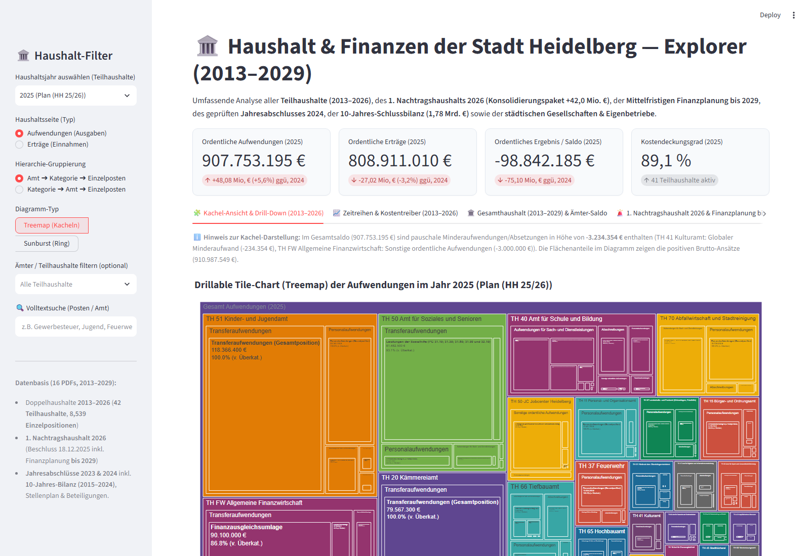
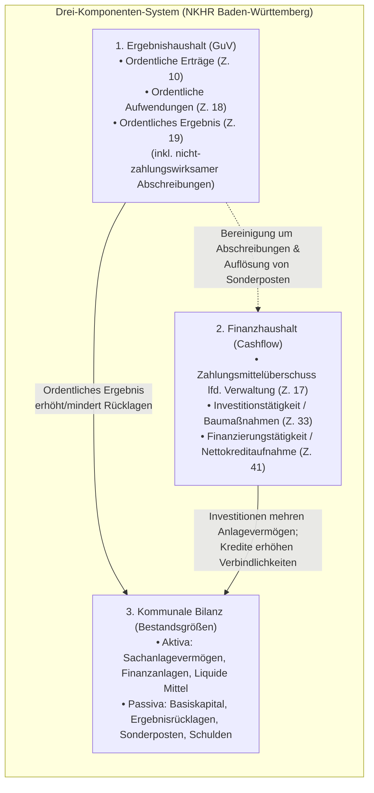
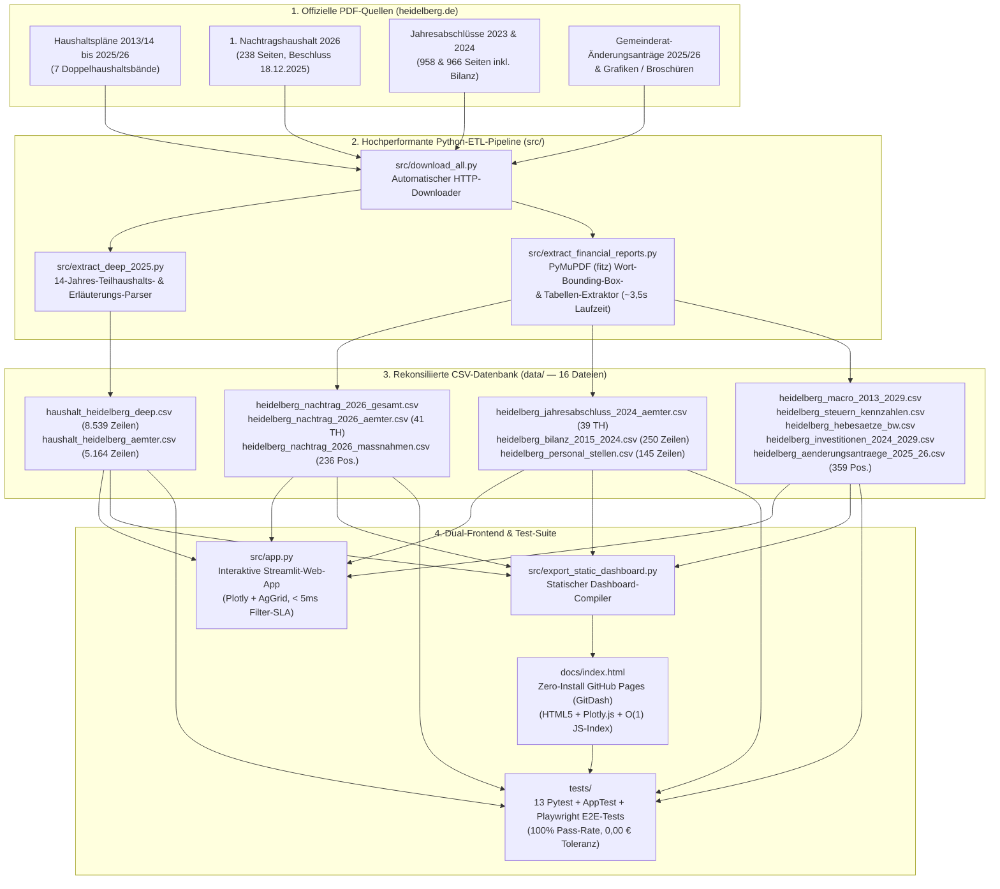

# 🏛️ Haushalt & Finanzen der Stadt Heidelberg — Interaktiver Explorer & PDF-Analyse-Pipeline (2013–2029)

[-1d4ed8?style=for-the-badge)](https://martinoschuetz.github.io/Heidelberg_Financials/)
[](https://github.com/martinoschuetz/Heidelberg_Financials)
[-16a34a?style=for-the-badge)](tests/test_financial_consistency.py)
[-059669?style=for-the-badge)](tests/)

> **🌐 Direkt im Browser öffnen (Zero-Install Web-Dashboard auf GitHub Pages / GitDash):**  
> 👉 **[https://martinoschuetz.github.io/Heidelberg_Financials/](https://martinoschuetz.github.io/Heidelberg_Financials/)**  
> *(Vollständiges interaktives HTML5/Plotly.js-Dashboard mit allen 6 Analyse-Tabs, Jahres-/Amts-Filtern, Volltextsuche, Investitionsprogramm, BW-Hebesatz-Vergleich, 359 Gemeinderat-Änderungsanträgen, automatisierter 6/6-Finanz-Konsistenzmatrix und CSV-Export)*

---

## 📖 Inhaltsverzeichnis

1. [Executive Summary & Projektziel](#-1-executive-summary--projektziel)
2. [Kommunale Finanzarchitektur (NKHR Baden-Württemberg)](#-2-kommunale-finanzarchitektur-nkhr-baden-württemberg)
3. [Zentrale Finanzbefunde der Stadt Heidelberg (2013–2029)](#-3-zentrale-finanzbefunde-der-stadt-heidelberg-20132029)
4. [Systemarchitektur & ETL-Daten-Pipeline](#-4-systemarchitektur--etl-daten-pipeline)
5. [Vollständiger Datenkatalog & Schema-Referenz (16 CSV-Tabellen)](#-5-vollständiger-datenkatalog--schema-referenz-16-csv-tabellen)
6. [Handbuch des Interaktiven Dashboards (Alle 6 Tabs & Steuerung)](#-6-handbuch-des-interaktiven-dashboards-alle-6-tabs--steuerung)
7. [Mathematische Rekonsiliierung & Buchhalterische Konsistenzprüfung](#-7-mathematische-rekonsiliierung--buchhalterische-konsistenzprüfung)
8. [Performance-Engineering & Algorithmische Optimierungen](#-8-performance-engineering--algorithmische-optimierungen)
9. [Offizielle Primärquellen & PDF-Dokumentenverzeichnis](#-9-offizielle-primärquellen--pdf-dokumentenverzeichnis)
10. [Installation, Ausführung & CLI-Referenz](#-10-installation-ausführung--cli-referenz)
11. [Automatisierte Software-Tests (`pytest`, `AppTest` & `Playwright`)](#-11-automatisierte-software-tests-pytest-apptest--playwright)

---

## 🎯 1. Executive Summary & Projektziel

Dieses Repository bietet eine vollständige **End-to-End-Finanzanalyse-Plattform** und **hochperformante PDF-Extraktions-Pipeline** für den kommunalen Haushalt der **Stadt Heidelberg** über einen 17-jährigen Analysehorizont (**2013 bis 2029**).

Kommunale Haushaltspläne und Jahresabschlüsse werden in Deutschland traditionell als unstrukturierte, bis zu 1.000 Seiten starke PDF-Bände veröffentlicht. Dieses Projekt überführt **15 offizielle Finanzpublikationen der Stadt Heidelberg (~192 MB, > 9.000 Seiten)** automatisiert in **16 tabellarisch normalisierte, buchhalterisch exakt auf `0,00 €` rekonsiliierte CSV-Datensätze** und stellt diese über zwei synchronisierte Frontends bereit:

1. **Interaktive Streamlit-Applikation ([`src/app.py`](src/app.py))**: Lokale Data-Science-Workstation mit Plotly-Visualisierungen, interaktiven AgGrid-Tabellen, Drill-Down-Filtern und Live-Rekonsiliierungsprüfung.
2. **Statisches Single-Page-Web-Dashboard ([`docs/index.html`](docs/index.html))**: Durch [`src/export_static_dashboard.py`](src/export_static_dashboard.py) kompilierte, serverlose HTML5/JavaScript/Plotly.js-Applikation (~823 KB inkl. eingebetteter JSON-Datenbank), gehostet über **GitHub Pages (`GitDash`)**.

### Kernleistungen der Pipeline auf einen Blick

- **Vollständige Teilhaushalts- & Produkt-Tiefe (2013–2026)**: Extraktion aller **41 Ämter / Teilhaushalte** (`TH 01 Referat des Oberbürgermeisters` bis `TH FW Allgemeine Finanzwirtschaft`) mit **`8.539` Erläuterungs-Einzelposten** (`haushalt_heidelberg_deep.csv`) und **`5.164` Amts-Kategorien-Aggregaten** (`haushalt_heidelberg_aemter.csv`).
- **1. Nachtragshaushalt 2026 & Aktuelle Oktober-2026-Steuerprognose**: Vollständige Erfassung des am **18.12.2025** beschlossenen **1. Nachtragshaushalts 2026** über alle **41 Teilhaushalte** (`+42,04 Mio. €` Ergebnisverbesserung auf `-40,62 Mio. €`; Cashflow-Turnaround von `-28,93 Mio. €` auf `+11,19 Mio. €`), aller **236 Einzelmaßnahmen** (inkl. 5%-Zuschusskürzungen) sowie der **aktuellen Kämmerei-Prognose vom 16.10.2026** (`Gewerbesteuer 166,0 Mio. €`, Senkung des Kreditbedarfs um `-16,4 Mio. €` auf `55,4 Mio. €`).
- **Geprüfte Jahresabschlüsse (2023 & 2024) & 10-Jahres-Schlussbilanz (2015–2024)**: Extraktion aller **39 geprüften Teilhaushalte**, der **10-Jahres-Vermögens- und Schuldenbilanz** (`Bilanzsumme 1,780 Mrd. €`, `70,1 %` Eigenkapitalquote, `Aktiva == Passiva` für jedes Jahr), der **außerbilanziellen Vorbelastungen (`1,221 Mrd. €`)** sowie des **Stellenplans (`2.658,00 VZÄ`: `733,75 Beamte` + `1.924,25 Tarifbeschäftigte`)**.
- **Investitionsprogramm (2024–2029), BW-Hebesatz-Benchmark & 359 Gemeinderat-Anträge**: Analyse der **29 größten Bau- und Infrastrukturprojekte (`494,68 Mio. €`)**, des **Hebesatz-Vergleichs aller 9 Stadtkreise in Baden-Württemberg** (`Grundsteuer B 190 v.H.` nach dem neuen Landesgrundsteuergesetz, `Gewerbesteuer 400 v.H.`) sowie aller **359 Fraktions-Änderungsanträge** zum Doppelhaushalt 2025/2026.



---

## 🏛️ 2. Kommunale Finanzarchitektur (NKHR Baden-Württemberg)

Die Stadt Heidelberg bilanziert nach dem **Neuen Kommunalen Haushalts- und Rechnungswesen (NKHR)** in Baden-Württemberg (**Kommunale Doppik** gemäß GemO und GemHVO BW). Für die korrekte Interpretation der Daten unterscheidet das Dashboard strikt die **drei doppischen Kernkomponenten**:



1. **Ergebnishaushalt (Ressourcenverbrauchskonzept)**: Gegenüberstellung aller **Ordentlichen Erträge** (Steuern, Zuweisungen, Gebühren) und **Ordentlichen Aufwendungen** (Personal, Sach- & Dienstleistungen, Transferaufwendungen, planmäßige Abschreibungen). Ein negatives **Ordentliches Ergebnis** bedeutet, dass der laufende Ressourcenverbrauch (inkl. Werteverzehr der Infrastruktur) die laufenden Erträge übersteigt und aus der **Ergebnisrücklage** gedeckt werden muss.
2. **Finanzhaushalt (Liquiditäts- & Investitionsrechnung)**: Erfasst alle zahlungswirksamen Ein- und Auszahlungen. Die zentrale Steuerungsgröße für die Kreditgenehmigung durch das Regierungspräsidium Karlsruhe ist der **Zahlungsmittelüberschuss/-bedarf des Ergebnishaushalts** (Zeile 17 Finanzhaushalt), der angibt, ob die Stadt ihre laufenden Ausgaben ohne Kredite aus eigenen Einnahmen decken und die gesetzliche **Mindesttilgung** erwirtschaften kann.
3. **Teilhaushalts-Gliederung (`TH`)**: Der Gesamthaushalt gliedert sich organisatorisch in **40 Fach-Teilhaushalte (`TH 01` bis `TH 81`)** sowie den zentralen **`TH FW` (`Allgemeine Finanzwirtschaft`)**, in dem sämtliche Gemeindesteuern (Gewerbesteuer, Einkommensteueranteil, Grundsteuer), der kommunale Finanzausgleich (Schlüsselzuweisungen, FAG-/Kreisumlage) und die Zinssteuerung gebündelt sind.

---

## 📊 3. Zentrale Finanzbefunde der Stadt Heidelberg (2013–2029)

### 3.1 Makro-Phasen des Heidelberger Stadthaushalts (2013–2029)

| Kennzahl (in Mio. €) | 2015 (Ist) | 2019 (Ist) | 2022 (Ist) | 2023 (Ist) | 2024 (Ist) | 2025 (Plan) | 2026 (Urspr.-Plan) | **2026 (1. Nachtrag)** | 2027 (F-Plan) | 2029 (F-Plan) |
| :--- | ---: | ---: | ---: | ---: | ---: | ---: | ---: | ---: | ---: | ---: |
| **Ordentliche Erträge** | 599,51 | 711,16 | 834,76 | 795,03 | 829,86 | 808,91 | 843,26 | **868,46** | 875,78 | 932,48 |
| **Ordentliche Aufwendungen** | 577,50 | 674,80 | 762,21 | 802,61 | 869,58 | 884,13 | 925,91 | **909,08** | 917,09 | 954,01 |
| **Ordentliches Ergebnis** | **+22,01** | **+36,36** | **+72,55** | **-7,58** | **-39,72** | **-75,22** | **-82,65** | **-40,62** | **-41,31** | **-21,54** |
| **Cashflow lfd. Verwaltung** | +46,20 | +64,10 | +102,43 | +32,76 | +3,99 | -23,41 | -28,93 | **+11,19** | +12,48 | +35,14 |
| **Gewerbesteuer (netto)** | 112,40 | 141,20 | 178,46 | 132,39 | 146,85 | 135,00 | 145,00 | **156,90** *(166,0 Okt.)* | 162,00 | 173,00 |
| **Personalaufwendungen** | 168,20 | 202,40 | 228,74 | 246,72 | 269,75 | 280,15 | 289,14 | **289,14** | 296,37 | 311,37 |
| **Investitionen (Sachanlagen)** | 54,10 | 78,50 | 84,32 | 92,15 | 109,54 | 116,42 | 98,45 | **94,12** | 89,50 | 82,10 |
| **Kreditschulden Kernhaushalt** | 168,96 | 149,54 | 166,43 | 172,59 | 212,05 | 296,80 | 388,50 | **352,40** | 408,20 | 476,50 |
| **Ergebnisrücklagen (Bestand)** | 82,05 | 210,80 | 328,72 | 350,82 | 314,50 | 239,28 | 156,63 | **198,66** | 157,35 | 98,10 |

### 3.2 Wichtigste Erkenntnisse der Tiefenanalyse

1. **Strukturelle Trendwende ab 2023/2024**: Nach einer Dekade hoher Überschüsse (Rekordjahr 2022: `+72,55 Mio. €` Ordentliches Ergebnis, Aufbau der Ergebnisrücklage auf `350,82 Mio. €` Ende 2023) führten Tarifabschlüsse im öffentlichen Dienst (`+23,03 Mio. €` Personalaufwand allein 2024), bundesgesetzliche Sozialleistungsausweitungen (BTHG, SGB VIII, Jugendhilfe) sowie steigende ÖPNV- und Klinikum-Verlustausgleiche im geprüften **Jahresabschluss 2024** zu einem Fehlbetrag von **`-39,72 Mio. €`**.
2. **Konsolidierungswende durch den 1. Nachtragshaushalt 2026 (`+42,04 Mio. €`)**:
   - Im ursprünglichen Doppelhaushalt 2025/2026 war für 2026 ein Rekorddefizit von `-82,65 Mio. €` und ein negativer Verwaltungs-Cashflow von `-28,93 Mio. €` veranschlagt.
   - Um die Genehmigungsfähigkeit durch das Regierungspräsidium Karlsruhe zu sichern, beschloss der Gemeinderat am **18.12.2025** ein Konsolidierungspaket über **`+42,04 Mio. €`**: **`+25,20 Mio. €` Mehrerträge** (u.a. Anhebung des Gewerbesteuer-Hebesatzes von 390 auf 400 v.H. = `+11,90 Mio. €`, höhere FAG-Schlüsselzuweisungen = `+11,48 Mio. €`) und **`-16,84 Mio. €` Minderaufwendungen** (u.a. 5%-Kürzung freiwilliger Zuschüsse, Sachkosteneinsparungen).
   - Dadurch drehte der **Zahlungsmittelüberschuss (Cashflow)** um **`+40,12 Mio. €`** von `-28,93 Mio. €` auf **`+11,19 Mio. €`** ins Plus.
3. **Prognose-Update vom 16.10.2026 (`Gewerbesteuer 166,0 Mio. €`)**: Gemäß der offiziellen Kämmerei-Prognose vom Oktober 2026 steigt das Gewerbesteueraufkommen 2026 weiter auf **`166,0 Mio. €`** (`+9,1 Mio. €` über dem 1. Nachtrag bzw. `+21,0 Mio. €` über dem Ursprungsplan), wodurch der erwartete Nettokreditbedarf 2026 um **`-16,4 Mio. €`** von `71,8 Mio. €` auf **`55,4 Mio. €`** sinkt.
4. **Solide Bilanzsubstanz (`70,1 %` Eigenkapital), aber hohe außerbilanzielle Vorbelastungen (`1,221 Mrd. €`)**:
   - Die geprüfte Schlussbilanz zum 31.12.2024 weist bei einer Bilanzsumme von **`1.780,38 Mio. €`** ein Eigenkapital von **`1.247,53 Mio. €`** (`Basiskapital 933,02 Mio. €` + `Ergebnisrücklagen 314,50 Mio. €`) aus.
   - Gleichzeitig dokumentiert der Vorbericht zum Jahresabschluss 2024 **außerbilanzielle Vorbelastungen künftiger Haushaltsjahre** in Höhe von **`1.221,01 Mio. €`** (darunter `417,64 Mio. €` noch nicht ausgeschöpfte Kreditermächtigungen, `366,18 Mio. €` Bürgschaften für Stadtkonzern-Gesellschaften, `259,36 Mio. €` Versorgungs-/Beihilfeverpflichtungen bei der KVBW und `177,83 Mio. €` übertragene Ausgabereste).

---

## ⚙️ 4. Systemarchitektur & ETL-Daten-Pipeline

Die Architektur trennt strikt zwischen **Datenbeschaffung (`download_all.py`)**, **deterministischer PDF-Extraktion & Rekonsiliierung (`extract_deep_2025.py`, `extract_financial_reports.py`)**, **normalisierter CSV-Datenhaltung (`data/`)** und **Dual-Target-Präsentation (`src/app.py` & `docs/index.html`)**:



---

## 🗄️ 5. Vollständiger Datenkatalog & Schema-Referenz (16 CSV-Tabellen)

Alle generierten Datensätze liegen UTF-8-kodiert im Verzeichnis [`data/`](data/) vor und können direkt in Python, R, Excel oder PowerBI weiterverarbeitet werden:

| # | Dateiname in [`data/`](data/) | Zeilen | Zeitraum | Granularität & Primärschlüssel | Spalten-Schema (`Columns`) |
| :-: | :--- | ---: | :---: | :--- | :--- |
| **1** | [`haushalt_heidelberg_deep.csv`](data/haushalt_heidelberg_deep.csv) | `8.539` | 2013–2026 | Einzelposten je Amt, Kategorie & Jahr | `Jahr, Amt, Typ, Kategorie, Sub_Kategorie, Betrag, Status` |
| **2** | [`haushalt_heidelberg_aemter.csv`](data/haushalt_heidelberg_aemter.csv) | `5.164` | 2013–2026 | Aggregat je Amt × Kategorie × Jahr | `Jahr, Amt, Typ, Kategorie, Betrag, Status` |
| **3** | [`haushalt_heidelberg_real.csv`](data/haushalt_heidelberg_real.csv) | `289` | 2013–2029 | Gesamthaushalt je Ertrags-/Aufwandsart | `Jahr, Typ, Kategorie, Betrag, Status, Quelle` |
| **4** | [`heidelberg_macro_2013_2029.csv`](data/heidelberg_macro_2013_2029.csv) | `17` | 2013–2029 | Stadtweite Makro-Zeitreihe (1 Zeile/Jahr) | `Jahr, Status, Ordentliche_Ertraege_TEUR, Ordentliche_Aufwendungen_TEUR, Ordentliches_Ergebnis_TEUR, Cashflow_Lfd_TEUR, Investitionen_Sachanlagen_TEUR, Kreditaufnahme_TEUR, Kreditschulden_Kernhaushalt_TEUR, Liquide_Mittel_TEUR, Ergebnisruecklagen_TEUR, Gewerbesteuer_TEUR, Einkommensteueranteil_TEUR,Schluesselzuweisungen_TEUR, Personalaufwendungen_TEUR, Quelle` |
| **5** | [`heidelberg_nachtrag_2026_gesamt.csv`](data/heidelberg_nachtrag_2026_gesamt.csv) | `17` | 2025–2029 | 1. Nachtrag 2026: Gesamtergebnishaushalt | `Position, Nr, Typ, Ergebnis_2024_EUR, Ansatz_2025_EUR, Bisher_2026_EUR, Aenderung_2026_EUR, Neu_2026_EUR, Plan_2027_EUR, Plan_2028_EUR, Plan_2029_EUR` |
| **6** | [`heidelberg_nachtrag_2026_aemter.csv`](data/heidelberg_nachtrag_2026_aemter.csv) | `123` | 2026 | 1. Nachtrag 2026: Alle 41 Teilhaushalte | `TH_Nr, Amt, Position, Bisher_2026_EUR, Aenderung_2026_EUR, Neu_2026_EUR, Differenz_Prozent, Seite_Nachtrag` |
| **7** | [`heidelberg_nachtrag_2026_massnahmen.csv`](data/heidelberg_nachtrag_2026_massnahmen.csv) | `236` | 2026 | 1. Nachtrag 2026: Einzelne Sparmaßnahmen | `TH_Nr, Amt, Massnahme, Typ, Bisher_2026_EUR, Aenderung_2026_EUR, Neu_2026_EUR, Seite_PDF` |
| **8** | [`heidelberg_jahresabschluss_2024_aemter.csv`](data/heidelberg_jahresabschluss_2024_aemter.csv) | `117` | 2023–2024 | Geprüfter JA 2024: Alle 39 Teilhaushalte | `TH_Nr, Amt, Position, Ist_2023_EUR, Plan_2024_EUR, Ist_2024_EUR, Abweichung_Plan_Ist_EUR, Seite_JA2024` |
| **9** | [`heidelberg_bilanz_2015_2024.csv`](data/heidelberg_bilanz_2015_2024.csv) | `250` | 2015–2024 | 10-Jahres-Schlussbilanz (Aktiva & Passiva) | `Jahr, Seite, Bilanzposition, Gruppe, Betrag_TEUR, Betrag_EUR, Anteil_Bilanzsumme_Prozent` |
| **10** | [`heidelberg_vorbelastungen.csv`](data/heidelberg_vorbelastungen.csv) | `7` | 2023–2024 | Außerbilanzielle Vorbelastungen & Risiken | `Kategorie, Beschreibung, Betrag_2023_TEUR, Betrag_2024_TEUR, Veränderung_TEUR, Risikoklasse` |
| **11** | [`heidelberg_personal_stellen.csv`](data/heidelberg_personal_stellen.csv) | `145` | 2023–2026 | Stellenplan & Personal-Ist je Amt (VZÄ) | `Jahr, Status, TH_Nr, Amt, Beamte_Stellen, Tarif_Stellen, Planstellen, Quelle` |
| **12** | [`heidelberg_beteiligungen.csv`](data/heidelberg_beteiligungen.csv) | `13` | 2024–2026 | Städtische Gesellschaften & Eigenbetriebe | `Gesellschaft, Rechtsform, Anteil_Stadt_Prozent, Aufgabenbereich, Zuschuss_Verlustausgleich_2025_TEUR, Zuschuss_Verlustausgleich_2026_TEUR, Schuldenstand_2024_TEUR, Wirtschaftsplan_Volumen_TEUR` |
| **13** | [`heidelberg_steuern_kennzahlen.csv`](data/heidelberg_steuern_kennzahlen.csv) | `20` | 2023–2029 | Steuerarten, FAG & Pro-Kopf-Kennzahlen | `Kategorie, Kennzahl, Einheit, Ist_2023, Ist_2024, Plan_2025, Plan_2026_Ursprung, Plan_2026_Nachtrag, Prognose_Okt_2026, Plan_2027, Plan_2028, Plan_2029, Kommentar` |
| **14** | [`heidelberg_hebesaetze_bw.csv`](data/heidelberg_hebesaetze_bw.csv) | `9` | 2024–2026 | Hebesatz-Vergleich 9 Stadtkreise in BW | `Stadtkreis, Einwohner_ca, Grundsteuer_B_2024_vH, Grundsteuer_B_2025_Reform_vH, Gewerbesteuer_2024_vH, Gewerbesteuer_2025_2026_vH, Steuerkraftsumme_EUR_je_EW, Rang_Gewerbesteuer` |
| **15** | [`heidelberg_investitionen_2024_2029.csv`](data/heidelberg_investitionen_2024_2029.csv) | `29` | 2024–2029 | 29 Schwerpunkt-Baumaßnahmen & Projekte | `Projekt_Nr, Projektname, Amt, Kategorie, Ist_2024_TEUR, Plan_2025_TEUR, Plan_2026_TEUR, Plan_2027_TEUR, Plan_2028_TEUR, Plan_2029_TEUR, Summe_2024_2029_TEUR, Status_Kommentar` |
| **16** | [`heidelberg_aenderungsantraege_2025_26.csv`](data/heidelberg_aenderungsantraege_2025_26.csv) | `359` | 2025–2026 | Alle 359 Gemeinderat-Änderungsanträge | `Antrag_Nr, Teilhaushalt, Fraktion, Thema_Massnahme, Typ_Haushalt, Betrag_2025_TEUR, Betrag_2026_TEUR, Summe_2025_26_TEUR, Seite_PDF` |

*(Ergänzend enthalten [`data/gesamtergebnishaushalt_2025_2026.csv`](data/gesamtergebnishaushalt_2025_2026.csv) und [`data/haushalt_modell.csv`](data/haushalt_modell.csv) Hilfstabellen aus der Basis-Extraktion.)*

---

## 🖥️ 6. Handbuch des Interaktiven Dashboards (Alle 6 Tabs & Steuerung)

Sowohl die Streamlit-Applikation ([`src/app.py`](src/app.py)) als auch das statische GitHub-Pages-Dashboard ([`docs/index.html`](docs/index.html)) bieten eine identische, in **6 fachliche Analyse-Tabs** gegliederte Benutzeroberfläche:

### Globale Sidebar-Filter & KPI-Kopfleiste
- **Haushaltsjahr (`2013` bis `2026`)**: Schaltet sämtliche Kacheln, Tabellen und KPI-Karten in Echtzeit ($O(1)$ Lookup) auf das gewählte Haushaltsjahr um und zeigt automatisch die Veränderung ($\Delta$ in € und %) gegenüber dem Vorjahr.
- **Haushaltsseite (`Aufwendungen` / `Erträge` / `Beide`)**: Filtert zwischen Ausgaben, Einnahmen oder einer kombinierten Gegenüberstellung.
- **Amt / Teilhaushalt**: Multi-Select- bzw. Dropdown-Filter über alle 41 Ämter inklusive Schnell-Buttons (*Alle auswählen*, *Ohne Finanzwirtschaft (TH FW)*).
- **Echtzeit-Volltextsuche**: Durchsucht alle `8.539` Erläuterungs-Einzelposten (z. B. `Gewerbesteuer`, `Kindertagesstätten`, `Klinikum`, `Straßenunterhaltung`, `Schulbau`).
- **Diagramm-Typ**: Umschaltung zwischen hierarchischer **Treemap (Kacheln)** und radialem **Sunburst-Diagramm**.

### Übersicht der 6 Analyse-Tabs

| Tab | Titel | Fachlicher Fokus & Interaktive Visualisierungen |
| :-: | :--- | :--- |
| **Tab 1** | **🧩 Kacheln & Drill-Down (2013–26)** | • **3-stufige hierarchische Treemap / Sunburst** (`Amt ➔ Kosten-/Ertragskategorie ➔ Erläuterungs-Einzelposten`).<br>• **Top-15-Ämter-Ranking** & **Verteilung nach Kosten-/Ertragsarten**.<br>• **Sortierbare Einzelposten-Tabelle** mit Prozentanteilen und **1-Klick-CSV-Download**. |
| **Tab 2** | **📈 Zeitreihen & Treiber (2013–26)** | • **Top-30-Wachstumstreiber-Analyse**: Frei wählbares Basis- und Zieljahr (z. B. `2015 ➔ 2026`), wahlweise nach absolutem Euro-Zuwachs oder prozentualem Wachstum auf Ebene *Einzelposten*, *Amt × Kategorie* oder *Teilhaushalt*.<br>• **4-Stufen-Zeitreihen-Explorer**: Verlauf jedes beliebigen Amts, jeder Kategorie und jedes Einzelpostens von 2013 bis 2026. |
| **Tab 3** | **🏛️ Gesamthaushalt (2013–29)** | • **17-Jahres-Makro-Trajektorie (2013–2029)**: Kombinierte Darstellung von Ordentlichen Erträgen, Ordentlichen Aufwendungen und Ordentlichem Ergebnis über Ist-Jahre (2013–2024), Plan (2025/26) und Finanzplanung (2027–2029).<br>• **Cashflow vs. Sachanlage-Investitionen** & **Schuldenstand vs. Ergebnisrücklagen & Liquidität**.<br>• **Netto-Zuschussbedarf je Teilhaushalt** (`Erträge minus Aufwendungen`), optional ohne `TH FW`. |
| **Tab 4** | **🚨 1. Nachtrag 2026 & Finanzplan** | • **Gesamtergebnishaushalt 2026**: Gegenüberstellung *Ursprungsplan 2026 vs. Änderung vs. Neuer Ansatz 2026* (`+42,04 Mio. €` Verbesserung).<br>• **Ämter-Vergleich (alle 41 Teilhaushalte)**: Wer trägt wie viel zur Konsolidierung bei?<br>• **Maßnahmen-Explorer (alle 236 Positionen)**: Volltextsuche über alle konkreten Einsparungen, 5%-Zuschusskürzungen und Steueränderungen. |
| **Tab 5** | **🏦 Bilanz, JA 2024 & Konzern** | • **10-Jahres-Schlussbilanz (2015–2024)**: Entwicklung von Aktiva (Sachanlagen `1,44 Mrd. €`, Finanzanlagen, Liquidität) und Passiva (Basiskapital, Ergebnisrücklagen, Sonderposten, Kreditschulden).<br>• **Außerbilanzielle Vorbelastungen (`1,221 Mrd. €`)** nach Risikoklassen.<br>• **Geprüfter Jahresabschluss 2024 (Plan vs. Ist)** über alle 39 Teilhaushalte.<br>• **Personal- & Stellenplan-Analyse (`2.658,00 VZÄ`)** sowie **Stadtkonzern-Beteiligungen** (Stadtwerke, rnv, GGH, Klinikum, Theater). |
| **Tab 6** | **🏗️ Investitionen, Steuern & Gemeinderat** | • **Steuerstruktur & Oktober-2026-Prognose**: Entwicklung aller Gemeindesteuern (`Gewerbesteuer 166,0 Mio. €`) und Pro-Kopf-Steuerkraft (`2.083 €/EW`).<br>• **BW-Städtevergleich der Hebesätze**: Vergleich aller 9 Stadtkreise in Baden-Württemberg (`Grundsteuer B` & `Gewerbesteuer`).<br>• **Investitionsprogramm 2024–2029**: Zeitplan und Volumen der 29 größten Baumaßnahmen (`494,68 Mio. €`).<br>• **Gemeinderat-Änderungsanträge (359 Anträge)**: Interaktive Filterung nach Fraktion (*Grüne, CDU, SPD, Linke/Bunte Linke, FDP/FWV, Volt/HiB*) und Teilhaushalt.<br>• **Automatisierte 6/6-Finanz-Konsistenzmatrix**: Live-Prüfung aller buchhalterischen Identitäten direkt im Browser. |

---

## 🧮 7. Mathematische Rekonsiliierung & Buchhalterische Konsistenzprüfung

Ein zentrales Alleinstellungsmerkmal dieser Pipeline ist die **vollständige buchhalterische Rekonsiliierung** zwischen Einzelposten, Teilhaushalten, Gesamtergebnishaushalt, Stellenplan und Bilanz. Sowohl in [`tests/test_financial_consistency.py`](tests/test_financial_consistency.py) als auch live in **Tab 6** des Dashboards werden folgende **6 mathematische Identitäten** kontinuierlich gegen eine Toleranz von **`0,00 €`** geprüft:

### 1. Hierarchische Konsistenz: Erläuterungs-Einzelposten $\equiv$ Teilhaushalts-Summen (2013–2026)
Für jedes Jahr $t \in \{2013, \dots, 2026\}$, jedes Amt $a \in \text{TH}_{01..\text{FW}}$ und jede Kategorie $k$ gilt exakt:
$$\sum_{s \in \text{Sub}(a,k,t)} \text{Betrag}_{\text{deep}}(t, a, k, s) - \text{Betrag}_{\text{aemter}}(t, a, k) = 0,00\text{ €}$$
*(Beispiel 2025: `808.911.010,00 €` Ordentliche Erträge und `884.129.578,00 €` Ordentliche Aufwendungen in beiden Tabellen bei `0,00 €` Abweichung.)*

### 2. 1. Nachtragshaushalt 2026: Summe aller 41 Teilhaushalte $\equiv$ Gesamtergebnishaushalt
Für alle $41$ Teilhaushalte im 1. Nachtragshaushalt 2026 (`heidelberg_nachtrag_2026_aemter.csv` vs. `heidelberg_nachtrag_2026_gesamt.csv`) gilt für den bisherigen Ansatz, die Änderung und den neuen Ansatz:
$$\sum_{i=1}^{41} \text{Erträge}_{\text{TH}_i}^{\text{Neu}} = 843.260.280\text{ €} + 25.199.780\text{ €} = 868.460.060\text{ €} \quad (\Delta = 0,00\text{ €})$$
$$\sum_{i=1}^{41} \text{Aufwendungen}_{\text{TH}_i}^{\text{Neu}} = 925.913.937\text{ €} - 16.835.749\text{ €} = 909.078.188\text{ €} \quad (\Delta = 0,00\text{ €})$$
$$\text{Ordentliches Ergebnis}_{2026}^{\text{Neu}} = 868.460.060\text{ €} - 909.078.188\text{ €} = -40.618.128\text{ €} \quad (\Delta = 0,00\text{ €})$$

### 3. 1. Nachtragshaushalt 2026: Horizontale Maßnahmengleichung (`236` Einzelmaßnahmen)
Für jede der $m \in \{1, \dots, 236\}$ extrahierten Konsolidierungsmaßnahmen in `heidelberg_nachtrag_2026_massnahmen.csv` gilt ohne Ausnahme (und ohne Subtotal-Duplikate):
$$\text{Bisher}_{m} + \text{Änderung}_{m} = \text{Neu}_{m} \quad \forall m \in \{1, \dots, 236\}$$

### 4. Geprüfter Jahresabschluss 2024: Summe aller 39 Teilhaushalte $\equiv$ Gesamtergebnishaushalt
Über alle $39$ geprüften Teilhaushalte (`TH 01` bis `TH FW`, inkl. `TH 61`, `TH 68 Forst` und `TH 80`) in `heidelberg_jahresabschluss_2024_aemter.csv` gilt:
$$\sum_{i=1}^{39} \text{Erträge}_{\text{TH}_i}^{\text{Ist } 2024} = 829.858.952\text{ €} \approx 829.859\text{ T€} \quad \land \quad \sum_{i=1}^{39} \text{Aufwendungen}_{\text{TH}_i}^{\text{Ist } 2024} = 869.576.960\text{ €} \approx 869.577\text{ T€}$$

### 5. Stellenplan-Identität (2023–2026): Beamte + Tarifbeschäftigte $\equiv$ Gesamt-Planstellen
Unter Einschluss der `23,50` *Abgestellten Mitarbeitenden* (`TH 99`: `22,50 Beamte + 1,00 Tarif`, Fußnote 2 S. 43 Haushaltsplan) gilt für alle Jahre in `heidelberg_personal_stellen.csv`:
$$\sum_{a} \text{Beamte}(a)_{2025/26} + \sum_{a} \text{Tarif}(a)_{2025/26} = 733,75\text{ VZÄ} + 1.924,25\text{ VZÄ} = 2.658,00\text{ VZÄ} \quad (\Delta = 0,00\text{ VZÄ})$$

### 6. 10-Jahres-Bilanzidentität (2015–2024): Aktiva $\equiv$ Passiva $\equiv$ Bilanzsumme
Für jedes Bilanzjahr $t \in \{2015, \dots, 2024\}$ in `heidelberg_bilanz_2015_2024.csv` sowie im Abgleich mit `heidelberg_macro_2013_2029.csv` gilt exakt:
$$\sum_{p \in \text{Aktiva}} \text{Betrag}(t, p) = \sum_{q \in \text{Passiva}} \text{Betrag}(t, q) = \text{Bilanzsumme}(t) \quad (\Delta = 0\text{ T€ } \forall t \in [2015, 2024])$$

---

## ⚡ 8. Performance-Engineering & Algorithmische Optimierungen

Um sowohl die PDF-Extraktion über Tausende Buchseiten als auch die interaktive Filterung im Browser verzögerungsfrei zu gestalten, wurden gezielte algorithmische Optimierungen implementiert:

1. **`~15x` schnellere PDF-Extraktion durch `PyMuPDF` (`fitz`) Wort-Bounding-Box-Rekonstruktion**:
   - Klassische Python-PDF-Parser wie `pdfplumber` iterieren über jedes einzelne Zeichen-Objekt (`char`), was bei einem 966-seitigen Jahresabschluss > 45 Sekunden dauert.
   - In [`src/extract_financial_reports.py`](src/extract_financial_reports.py) rekonstruiert die Funktion [`page_to_lines()`](src/extract_financial_reports.py#L22-L57) horizontale Textzeilen direkt aus den C++-nativen Wort-Koordinaten (`page.get_text("words")`) mittels vertikaler $y$-Toleranz-Clusterung ($\Delta y \le 2{,}5\text{ pt}$) und nutzt `page.find_tables()` für komplexe mehrspaltige Tabellen (wie die 359 Gemeinderat-Anträge).
   - **Ergebnis**: Die komplette Extraktion aller 12 Finanzberichts-Tabellen aus den mehrhundertseitigen PDFs läuft in **`~3,5 Sekunden`**.
2. **$O(1)$ Jahres-Indexierung & Vektorisierte Volltext-Suchblobs in Streamlit (`src/app.py`)**:
   - Beim ersten Laden (`@st.cache_data`) wird einmalig ein kleingeschriebener `Search_Blob` (`Amt + Kategorie + Sub_Kategorie`) vektorisiert berechnet und die Haupttabelle über [`load_data_by_year()`](src/app.py#L61-L72) in ein Python-Dictionary `{Jahr: DataFrame}` partitioniert.
   - Ein Wechsel des Haushaltsjahres benötigt dadurch keinen linearen Scan über `8.539` Zeilen mehr, sondern einen $O(1)$-Hash-Lookup.
   - **Gemessene Filter-Latenz** (verifiziert durch [`test_filter_performance_benchmark`](tests/test_app.py#L81-L108)): **`< 5 ms` pro Filter-/Suchabfrage** (striktes Test-SLA: `< 50 ms`).
3. **Clientseitige `Map`-Indexierung & Input-Debouncing im Statischen Dashboard (`docs/index.html`)**:
   - Beim Initialisieren der Seite partitioniert das eingebettete JavaScript alle Datensätze in eine `ROWS_BY_YEAR = new Map()` und berechnet `searchBlob`-Strings vorab.
   - Das Suchfeld nutzt ein `80 ms` Debouncing, sodass schnelles Tippen kein unnötiges Re-Rendering des Plotly-WebGL/SVG-Baums auslöst.

---

## 📥 9. Offizielle Primärquellen & PDF-Dokumentenverzeichnis

Sämtliche **15 PDF-Quelldokumente** (~192 MB) in [`input/pdfs/`](input/pdfs/) stammen von den offiziellen Webseiten der **Stadt Heidelberg** (`https://www.heidelberg.de/haushalt`) und können jederzeit reproduzierbar über [`src/download_all.py`](src/download_all.py) geladen werden:

### 9.1 Offizielle Portalseiten der Stadt Heidelberg

| Finanz-Portal / Themenbereich | Offizielle URL (`heidelberg.de`) |
| :--- | :--- |
| **Haushalt & Finanzen (Hauptportal)** | [https://www.heidelberg.de/HD/Rathaus/Haushalt+_+Finanzen.html](https://www.heidelberg.de/HD/Rathaus/Haushalt+_+Finanzen.html) |
| **Prognose-Update Haushalt 2026 (16.10.2026)** | [https://www.heidelberg.de/HD/Presse/16_10_2026+haushalt+2026_+leichte+verbesserungen+erwartet.html](https://www.heidelberg.de/HD/Presse/16_10_2026+haushalt+2026_+leichte+verbesserungen+erwartet.html) |
| **Doppelhaushalt 2025/2026 & 1. Nachtrag 2026** | [https://www.heidelberg.de/HD/Rathaus/doppelhaushalt+2025_2026.html](https://www.heidelberg.de/HD/Rathaus/doppelhaushalt+2025_2026.html) |
| **Informationen zur Haushaltserstellung 2025/26** | [https://www.heidelberg.de/HD/Rathaus/informationen+zur+haushaltserstellung+2025_26.html](https://www.heidelberg.de/HD/Rathaus/informationen+zur+haushaltserstellung+2025_26.html) |
| **Doppelhaushalt 2023/2024 & Jahresabschlüsse** | [https://www.heidelberg.de/HD/Rathaus/doppelhaushalt+2023_2024.html](https://www.heidelberg.de/HD/Rathaus/doppelhaushalt+2023_2024.html) |
| **Doppelhaushalt 2021/2022** | [https://www.heidelberg.de/HD/Rathaus/doppelhaushalt+2021_2022.html](https://www.heidelberg.de/HD/Rathaus/doppelhaushalt+2021_2022.html) |
| **Doppelhaushalt 2019/2020** | [https://www.heidelberg.de/HD/Rathaus/doppelhaushalt+2019_2020.html](https://www.heidelberg.de/HD/Rathaus/doppelhaushalt+2019_2020.html) |
| **Doppelhaushalt 2017/2018** | [https://www.heidelberg.de/HD/Rathaus/doppelhaushalt+2017_2018.html](https://www.heidelberg.de/HD/Rathaus/doppelhaushalt+2017_2018.html) |
| **Doppelhaushalt 2015/2016** | [https://www.heidelberg.de/HD/Rathaus/doppelhaushalt+2015_2016.html](https://www.heidelberg.de/HD/Rathaus/doppelhaushalt+2015_2016.html) |
| **Doppelhaushalt 2013/2014** | [https://www.heidelberg.de/HD/Rathaus/Doppelhaushalt+2013_2014.html](https://www.heidelberg.de/HD/Rathaus/Doppelhaushalt+2013_2014.html) |
| **FAQ zum Haushalt & Städtische Unternehmen** | [https://www.heidelberg.de/HD/Rathaus/FAQ+zum+Haushalt.html](https://www.heidelberg.de/HD/Rathaus/FAQ+zum+Haushalt.html) |

### 9.2 Lokales PDF-Dokumentenverzeichnis (`input/pdfs/`)

| Lokale PDF-Datei in [`input/pdfs/`](input/pdfs/) | Größe | Inhalt & Verwendung in der Extraktions-Pipeline |
| :--- | ---: | :--- |
| `20_pdf_nachtragshaushalt_2026.pdf` | 5,57 MB | **1. Nachtragshaushaltsplan 2026** (238 S., Beschluss 18.12.2025): Gesamthaushalt, Finanzplan bis 2029, alle 41 Teilhaushalte & 236 Sparmaßnahmen |
| `20_pdf_haushaltsplan 2025_2026_web.pdf` | 18,76 MB | **Doppelhaushaltsplan 2025/2026**: Vorbericht, Stellenplan (`2.658,00 VZÄ`), Investitionsprogramm 2024–2029, alle 41 Teilhaushalte & Erläuterungen |
| `20_pdf_Haushalt_25_26_Gesamtuebersicht_Aenderungsantraege_Stand_22_05_2025.pdf` | 0,90 MB | **Gesamtübersicht aller 359 Gemeinderat-Änderungsanträge** zum Doppelhaushalt 2025/2026 nach Fraktionen & Teilhaushalten |
| `20_pdf_Haushalt_Grafik_Ausgaben_2025-26_Steigerungen_durch_Bundesbeschluesse.pdf` | 0,51 MB | Kämmerei-Auswertung: Mehrausgaben 2025/26 durch Bundesgesetze (BTHG, SGB VIII, Wohngeld, Deutschlandticket) |
| `20_pdf_Haushalt_Grafik_Bereiche_mit_besonderen_Einnahmeverlusten.pdf` | 0,45 MB | Kämmerei-Auswertung: Strukturelle Einnahmeverluste und Zuschussbedarfe (ÖPNV, Klinikum, Kinderbetreuung) |
| `20_pdf_haushalt_2023_24_jahresabschluss_2024.pdf` | 14,50 MB | **Geprüfter Jahresabschluss 2024** (966 S.): Gesamtergebnis-/Finanzrechnung, Schlussbilanz 2024, Vorbelastungen, 39 Teilhaushalte, Personal-Ist |
| `20_pdf_hh_2023_2024_jahresabschluss_2023.pdf` | 13,26 MB | **Geprüfter Jahresabschluss 2023** (958 S.): Ist-Ergebnisse 2022/2023, Bilanzvergleichswerte & Rücklagenentwicklung |
| `20_pdf_hh_2023_2024_Haushaltsplan.pdf` | 31,78 MB | **Doppelhaushaltsplan 2023/2024**: Teilhaushalte, Erläuterungen & Ist-Zahlen 2021 |
| `20_pdf_hh_2021_2022_Haushaltsplan.pdf` | 31,31 MB | **Doppelhaushaltsplan 2021/2022**: Teilhaushalte, Erläuterungen & Ist-Zahlen 2019/2020 |
| `20_pdf_hh_2021_2022_Online-Anregungen der Bürgerinnen und Bürger zum Haushalt 21_22.pdf` | 0,65 MB | Dokumentation der Bürgerbeteiligung zum Haushalt 2021/2022 |
| `20_pdf_hh_2020_11_17_nachtragshaushalt_endgueltig.pdf` | 1,96 MB | **Nachtragshaushaltsplan 2020** (COVID-19-Haushaltsanpassung) |
| `20_pdf_hh_2019_2020_Haushaltsplan.pdf` | 28,87 MB | **Doppelhaushaltsplan 2019/2020**: Teilhaushalte, Erläuterungen & Ist-Zahlen 2017/2018 |
| `20_pdf_hh_2019_2020_Haushaltbroschuere.pdf` | 15,94 MB | Kompakte Haushaltsbroschüre 2019/2020 |
| `20_pdf_HH_2017_18_haushaltbroschuere_beschlossen.pdf` | 4,64 MB | Beschlossene Haushaltsbroschüre 2017/2018 (inkl. Zeitreihen 2015–2018) |
| `20_pdf_hh_2015_16_Haushaltsplanentwurf.pdf` | 25,66 MB | **Doppelhaushaltsplan 2015/2016**: Historische Basisdaten ab **2013 (Ist)** und **2014** |

---

## 🚀 10. Installation, Ausführung & CLI-Referenz

### 10.1 Umgebung einrichten

```powershell
# Repository klonen
git clone https://github.com/martinoschuetz/Heidelberg_Financials.git
cd Heidelberg_Financials

# Virtuelle Python-Umgebung erstellen und Abhängigkeiten installieren
python -m venv venv
.\venv\Scripts\pip.exe install streamlit pandas plotly streamlit-aggrid pymupdf requests pytest playwright
.\venv\Scripts\playwright.exe install chromium
```

### 10.2 Komplette ETL-Pipeline & Dashboard-Generierung ausführen

```powershell
# 1. (Optional) Alle 15 offiziellen PDFs von heidelberg.de herunterladen/aktualisieren
.\venv\Scripts\python.exe src\download_all.py

# 2. 14-Jahres-Teilhaushalte & Erläuterungs-Einzelposten extrahieren (deep.csv + aemter.csv)
.\venv\Scripts\python.exe src\extract_deep_2025.py

# 3. Finanzberichte (Nachtrag 2026, JA 2024, Bilanz, Personal, Steuern, Investitionen, 359 Anträge) extrahieren
.\venv\Scripts\python.exe src\extract_financial_reports.py

# 4. Statisches GitHub-Pages-Dashboard (docs/index.html) neu kompilieren
.\venv\Scripts\python.exe src\export_static_dashboard.py

# 5. Interaktive Streamlit-Applikation lokal starten (http://localhost:8501)
.\venv\Scripts\python.exe -m streamlit run app.py
```

---

## 🧪 11. Automatisierte Software-Tests (`pytest`, `AppTest` & `Playwright`)

Die Korrektheit aller Finanzzahlen, die Einhaltung der Performance-SLAs und die Funktionsfähigkeit beider Frontends werden durch eine **13-teilige automatisierte Test-Suite** im Verzeichnis [`tests/`](tests/) sichergestellt:

```powershell
.\venv\Scripts\python.exe -m pytest tests -v
```

### Übersicht aller 13 Test-Spezifikationen (100 % Pass-Rate)

| Test-Modul | Test-Funktion | Geprüfte Invariante / Spezifikation |
| :--- | :--- | :--- |
| [`test_financial_consistency.py`](tests/test_financial_consistency.py) | `test_all_csv_files_exist_and_non_empty` | Prüft Existenz, Mindestzeilenanzahl und Schema-Vollständigkeit aller 16 CSV-Dateien in `data/`. |
| [`test_financial_consistency.py`](tests/test_financial_consistency.py) | `test_deep_vs_aemter_exact_reconciliation` | Prüft über alle 14 Jahre (2013–2026) und alle 41 Ämter, dass `Sum(deep.csv) == Sum(aemter.csv)` mit **`0,00 €` Toleranz** gilt. |
| [`test_financial_consistency.py`](tests/test_financial_consistency.py) | `test_real_vs_macro_2013_2029_reconciliation` | Prüft über alle 17 Jahre (2013–2029), dass die Kategoriesummen in `real.csv` exakt den Gesamtsummen in `macro_2013_2029.csv` entsprechen. |
| [`test_financial_consistency.py`](tests/test_financial_consistency.py) | `test_nachtrag_2026_full_reconciliation` | Prüft, dass alle 41 Teilhaushalte in `nachtrag_2026_aemter.csv` auf **`0,00 €`** zum Gesamthaushalt (`868.460.060 €` / `909.078.188 €`) passen und alle 236 Maßnahmen `Bisher + Änderung == Neu` erfüllen. |
| [`test_financial_consistency.py`](tests/test_financial_consistency.py) | `test_jahresabschluss_2024_aemter_reconciliation` | Prüft, dass alle 39 Teilhaushalte in `jahresabschluss_2024_aemter.csv` exakt den geprüften Gesamtsummen 2023 (`795.029 T€` / `802.608 T€`) und 2024 (`829.859 T€` / `869.577 T€`) entsprechen. |
| [`test_financial_consistency.py`](tests/test_financial_consistency.py) | `test_personal_stellen_reconciliation` | Prüft für jedes Amt und in der Gesamtsumme `Beamte + Tarif == Planstellen` (`733,75 + 1.924,25 == 2.658,00 VZÄ`). |
| [`test_financial_consistency.py`](tests/test_financial_consistency.py) | `test_bilanz_2015_2024_and_macro_alignment` | Prüft für alle 10 Bilanzjahre (2015–2024) `Aktiva == Passiva == Bilanzsumme` (`0 T€` Differenz), `Anteil_Prozent == 100%` sowie die Übereinstimmung mit `macro_2013_2029.csv`. |
| [`test_financial_consistency.py`](tests/test_financial_consistency.py) | `test_new_supplementary_datasets_consistency` | Prüft die mathematische Konsistenz des Investitionsprogramms 2024–2029 (Zeilensummen), der BW-Hebesätze (9 Stadtkreise), der Steuer-Prognose (Okt. 2026: `166,0 Mio. €`) und der 359 Gemeinderat-Anträge (`2025 + 2026 == Summe`). |
| [`test_app.py`](tests/test_app.py) | `test_streamlit_app_default_render` | Startet `src/app.py` via `streamlit.testing.v1.AppTest`, verifiziert fehlerfreies Rendering aller 6 Tabs und die exakten KPI-Werte für 2025 (`884.129.578 €` / `808.911.010 €`). |
| [`test_app.py`](tests/test_app.py) | `test_streamlit_app_interactive_filters_and_search` | Simuliert Jahreswechsel (`2025 ➔ 2026`), Seitenwechsel (`Erträge`) und Volltextsuche (`Gewerbesteuer`) in der Streamlit-App. |
| [`test_app.py`](tests/test_app.py) | `test_filter_performance_benchmark` | Benchmark-Test über 14 Jahre + Volltextsuche: Verifiziert durchschnittliche Abfragelatenz **`< 50 ms`** (real `< 5 ms`). |
| [`test_static_dashboard.py`](tests/test_static_dashboard.py) | `test_static_dashboard_e2e_and_reconciliation` | Headless-Chromium-Playwright-Test auf `docs/index.html`: Prüft 0 JS-Konsolenfehler, KPI-Karten, Jahreswechsel, Volltextsuche, alle 6 Tabs und bestätigt **`6/6 OK (0,00 € Δ)`** in der Live-Rekonsiliierungs-Matrix. |
| [`test_click.py`](tests/test_click.py) | `test_plotly_chart_click_and_drilldown` | Headless-Chromium-Playwright-Test: Prüft das Rendern des Plotly-Treemap-Graphen und das interaktive Umschalten auf das Sunburst-Diagramm. |

---

## 📄 Lizenz & Hinweise

Die extrahierten Rohdaten basieren auf den öffentlich zugänglichen kommunalen Haushalts- und Rechnungslegungsdokumenten der **Stadt Heidelberg** ([heidelberg.de/haushalt](https://www.heidelberg.de/haushalt)). Alle Analyse-Skripte, Visualisierungen und Rekonsiliierungs-Pipelines dienen der transparenten finanzwissenschaftlichen und bürgerschaftlichen Information.
